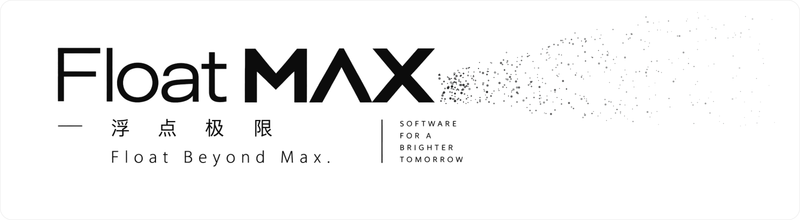

<picture>
  <source media="(prefers-color-scheme: dark)" srcset="assets/banner-dark.svg">
  
</picture>

<h3 align="center">浮越边界，探索极限。</h3>

Float Beyond Max. — Software for a brighter tomorrow.

  <a href="https://floatmax-tech.com/">官网 Website</a> ·
  <a href="mailto:contact@floatmax-tech.com">contact@floatmax-tech.com</a>

---

### [LimLink](https://limlink.floatmax-tech.com/)

局域网内，跨设备传文件。 
Send files across devices on your local network. No cloud.

Windows · Android · macOS · iOS · iPadOS — [下载 Download](https://limlink.floatmax-tech.com/) · [Releases](https://github.com/FloatMax-tech/LimLink-Releases)

---

### 上四休三 · Four days a week

每周工作四天，薪资不变。想一起做，[发一封信](mailto:careers@floatmax-tech.com)。 
Four-day week, full pay. Want to build with us? Write to careers@floatmax-tech.com.
